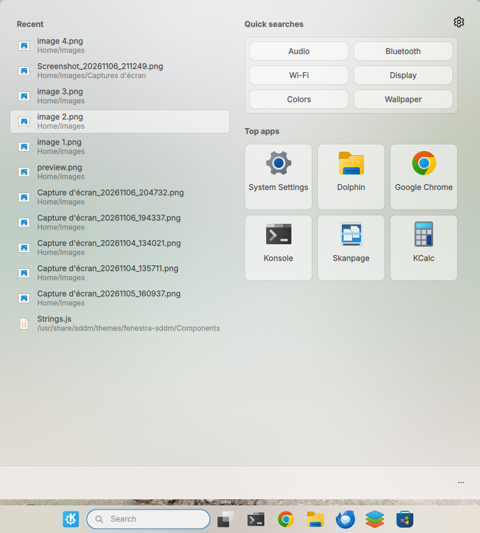

<p align="center"></p>

<h1 align="center">Fenestra Search</h1>

<p align="center">
A Windows 11-style search box for KDE Plasma 6.<br>
Part of the Fenestra series.
</p>

Fenestra Search adds a search box (or a simple magnifier) to your taskbar, with results grouped by category, a details pane on the right, a home page and quick searches. It is designed especially for people coming from Windows, so they do not feel lost on a KDE Plasma desktop.

<p align="center"></p>

## Features

- **Search box in the taskbar**, rounded like the Windows 11 one, or **a simple magnifier** if you prefer to save space (setting). One click and you type: the text appears in the box (or, in magnifier mode, in the bottom bar of the window), and the results in the window above.
- **Search for apps, files, folders and settings** through KRunner, the KDE search engine.
- **Best match** first, then results **grouped by category**, which can be **collapsed**. An exact match always wins (the file name counts without its extension: `report` finds `report.pdf` first).
- **Details pane** on the right, like Windows 11: the selected result in large size (with a preview for images and documents), **Open**, then the other actions: open file location, copy path, the application's own actions, edit it, manage it in Discover. For an application, its **recent files** are listed too.
- **Same window as Fenestra Menu 11**: same height and rounded corners, and the width follows the "Menu size" setting of Menu 11 (small, automatic or large).
- **Filters**: All, Apps, Documents, Images, Folders, Web, with a **back arrow** on the left to return to the home page.
- **Gear** at the top right: search settings (file indexing) and Fenestra Search configuration.
- **Calculator**: type `10+10`, the result is shown large at the top; a click copies it.
- **Document preview**: when the first result is a document, its thumbnail is shown at the top.
- **Web search** as the last line, with the engine of your choice: the one chosen in KDE (default), DuckDuckGo, Google, Bing, Qwant, Ecosia, Startpage or Brave Search.
- **Home page** when nothing is typed: recent documents, quick searches (Audio, Bluetooth, Wi-Fi, Display, Colors, Wallpaper) and most used apps, like the Start menu.
- **"···" menu** in the bottom bar: About.
- Keyboard: Up / Down, Enter to open, Esc to close.
- Follows light and dark themes.

## Requirements

- **KDE Plasma 6** (Qt 6). Plasma 5 is not supported.
- **Wayland** session. X11 is not supported.

## Installation

### From the KDE Store

Right-click the panel → **Add or Manage Widgets** → **Get New Widgets** → search for **Fenestra Search**.

Installed this way, the widget is updated automatically through **Discover** (KDE's software center), like any other KDE Store add-on.

### Manual

```bash
git clone https://github.com/naykkalak/fenestra-search.git
kpackagetool6 -t Plasma/Applet -i fenestra-search
```

Then right-click the panel → **Add or Manage Widgets** → **Fenestra Search**.

To update a manual install: `kpackagetool6 -t Plasma/Applet -u fenestra-search`.

## Settings

Right-click the search box → **Configure Fenestra Search…** (also in the gear): width of the search box, **show only a magnifier instead of the box**, and web search engine.

**Search settings** (in the gear) opens the KDE search settings: indexed folders and search sources. If file search finds nothing, check that indexing is enabled.

## Languages

English, Chinese (Simplified and Traditional), Dutch, French, German, Italian, Japanese, Polish, Portuguese (Portugal and Brazil), Russian, Spanish and Turkish. The widget follows the system language and falls back to English.

Translations other than French are machine-assisted and **should be reviewed by native speakers**: corrections are welcome (files in `translate/`).

## Credits

- Result ranking inspired by [MFile Search](https://github.com/MCC45TR/kde-plasma6-widgets/tree/main/file-search), by MCC45TR (GPL-3.0).
- **Icons**: back arrow and gear (`contents/icons/fluent/`): [Fluent UI System Icons](https://github.com/microsoft/fluentui-system-icons), © Microsoft Corporation, MIT license (see `LICENSE-fluentui-system-icons`). Magnifier: KDE-Windows-Modern icon theme, by Jeysef, GPL-3.0.

## Also in the Fenestra series

- [Fenestra Menu 11](https://github.com/naykkalak/fenestra-menu-11): start menu with KDE Connect panel
- [Fenestra Weather](https://github.com/naykkalak/fenestra-weather-icons): weather icon pack
- [Fenestra Weather Widget](https://github.com/naykkalak/fenestra-weather-widget): weather widget
- [Fenestra SDDM](https://github.com/naykkalak/fenestra-sddm): login screen
- [Fenestra This PC](https://github.com/naykkalak/fenestra-ce-pc): “This PC” window

## License

Fenestra Search is distributed under the **GNU General Public License v3.0 or later** (see [LICENSE](LICENSE)).

*Not affiliated with or endorsed by Microsoft. “Windows” is a trademark of Microsoft Corporation and is only used here to describe the style.*
